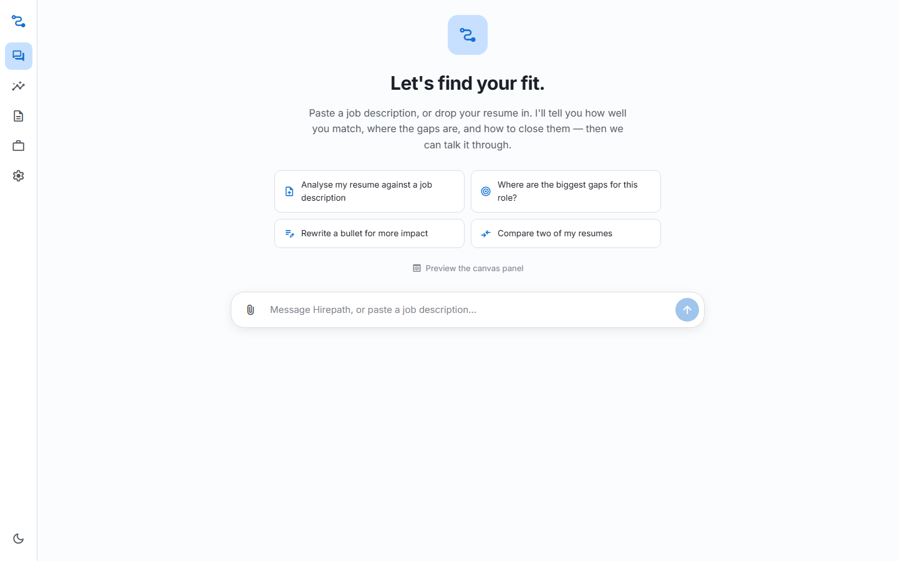
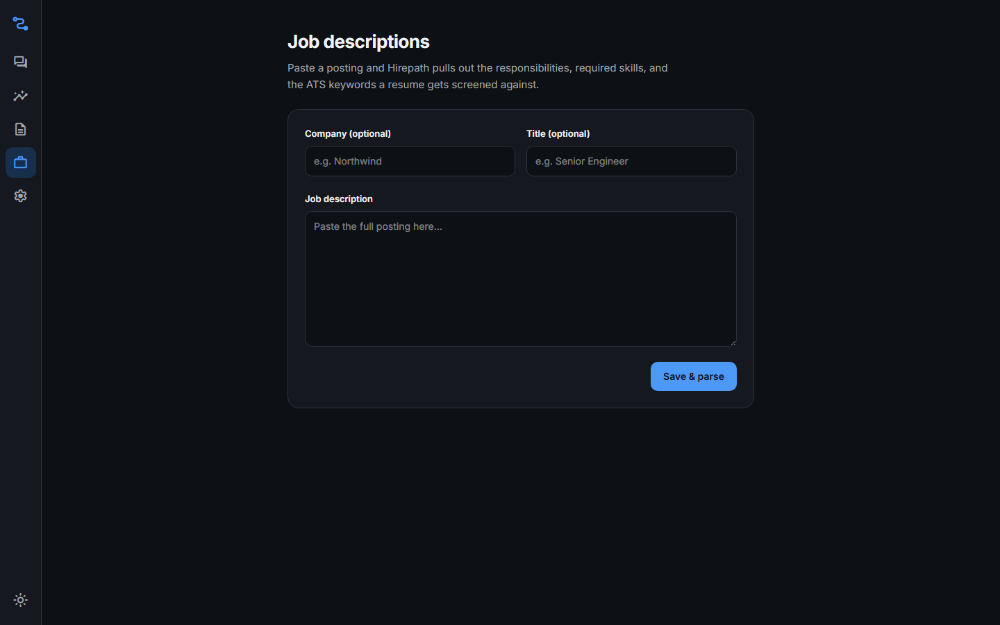
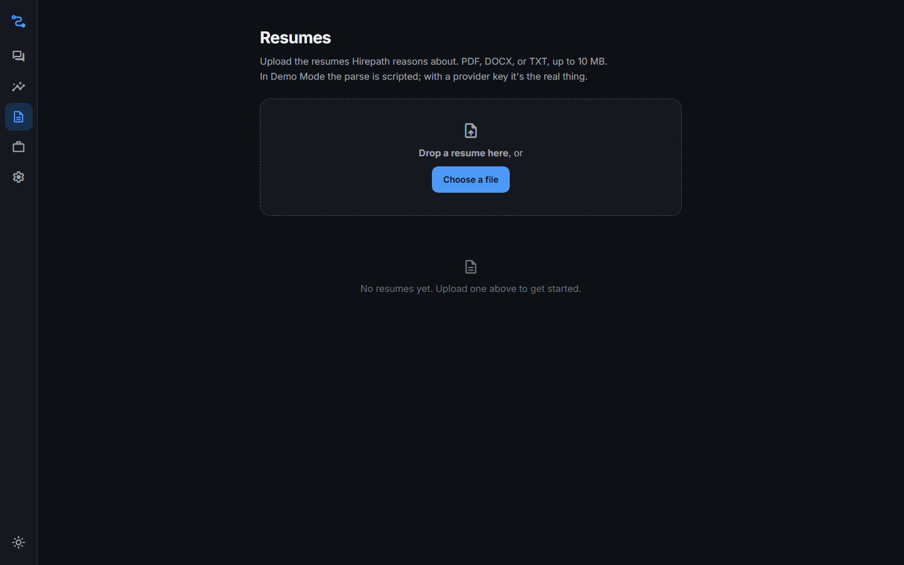
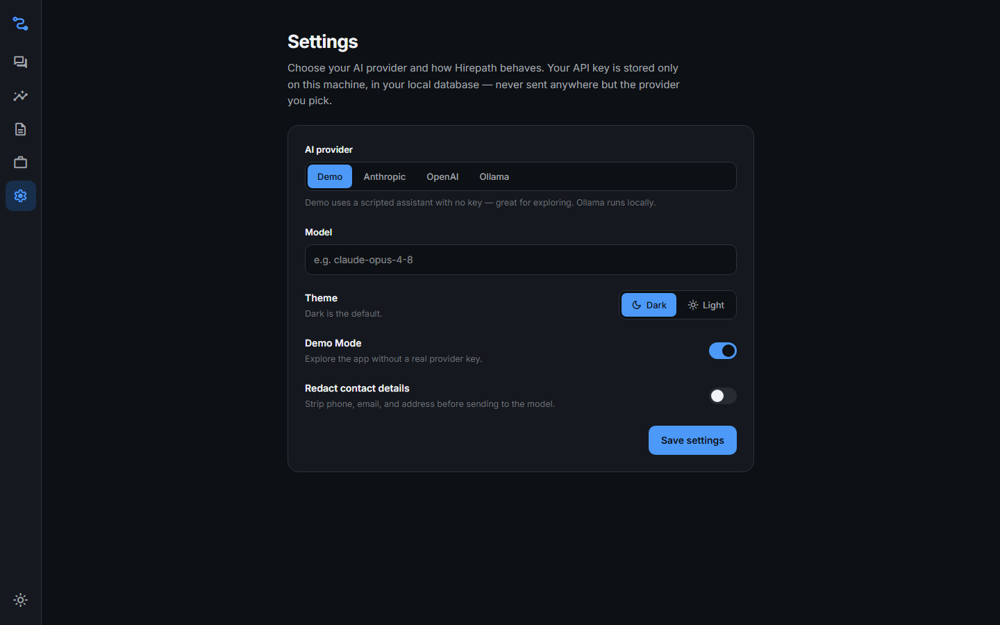

# Hirepath

A **local-first job-hunting companion**. Bring your resume and a job description;
Hirepath tells you how well you match, where the gaps are, and how to close them
— then keeps talking about it. Everything runs on your machine: a local API and a
local SQLite file. No accounts, no cloud.

**Chat is the interface.** The app opens to a conversation, not a dashboard. The
assistant operates the app through tools and answers with interactive widgets,
not walls of text. Everything the chat can do, you can also do by hand.

> **Status:** Phase 1 (Data and intake) complete. You can upload resumes
> (PDF/DOCX/TXT), paste and parse job descriptions, and configure settings, all
> explorable in Demo Mode without an API key. Match scoring, real AI providers,
> and the conversational assistant are next (Phases 2–3). See
> [`docs/ROADMAP.md`](docs/ROADMAP.md) and [`docs/FEATURES.md`](docs/FEATURES.md).

| Chat (light) | Job descriptions (dark) |
| :---: | :---: |
|  |  |
| **Resumes (dark)** | **Settings (light)** |
|  |  |

## Highlights

- **Clean architecture, enforced:** `Domain ← Application ← Infrastructure/Api`.
  Scoring logic is pure functions in `Domain`, unit-tested without a database or
  a model.
- **One implementation, two entry points:** use-case handlers serve both the
  REST endpoints and (Phase 3) the chat assistant's tools.
- **Typed end to end:** ASP.NET Core Minimal API emits OpenAPI at build time;
  NSwag generates the Angular client, so the front end can't drift from the API.
- **Modern Angular 22:** standalone components, signals, zoneless change
  detection, Tailwind v4 + Material, oklch design tokens with dark and light
  themes.
- **Testable AI:** a deterministic `FakeChatClient` powers Demo Mode and every
  test. No automated test touches the network.
- **Tested:** xUnit (backend), Vitest + Testing Library (frontend), Playwright
  (e2e). Decisions are recorded as ADRs in [`docs/decisions/`](docs/decisions/).

## Prerequisites

- **.NET 10 SDK** — <https://dotnet.microsoft.com/download>
- **Node 22.22+ or 24.x** — <https://nodejs.org>
- No database to install; SQLite ships with EF Core.

## One-command start

```pwsh
./run.ps1        # Windows (PowerShell)
```

```bash
./run.sh         # macOS / Linux
```

This restores, builds, generates the API client, and starts the API
(`https://localhost:7180`) plus the Angular dev server (`http://localhost:4200`,
proxied to the API). Open <http://localhost:4200>.

### Manual two-terminal path

```bash
# Terminal 1 — API
dotnet run --project src/Hirepath.Api

# Terminal 2 — web
cd src/Hirepath.Web
npm install
npm run generate:api   # regenerate the typed API client
npm start
```

## Configuring an AI provider

Open **Settings** in the app and pick a provider — Anthropic, OpenAI, or
Ollama — then paste your API key and choose a model (the live provider clients
arrive in Phase 2; until then the app runs in Demo Mode). The key is stored only in
your local SQLite database; it is never written to source, never logged, and
never sent anywhere but your chosen provider. Developers can override via
`dotnet user-secrets` or environment variables.

## Demo Mode

Demo Mode lets you explore the whole app **without an API key**, powered by a
deterministic fake AI client. It is how the UI is reviewed and how the e2e tests
run. It is on by default; toggle it in Settings.

## Scripts

| Command | What it does |
| :--- | :--- |
| `./run.ps1` / `./run.sh` | Start API + web together |
| `./verify.ps1` / `./verify.sh` | Run every verification gate |
| `dotnet build Hirepath.slnx` | Build the backend |
| `dotnet test Hirepath.slnx` | Backend tests |
| `cd src/Hirepath.Web && npm start` | Angular dev server |
| `cd src/Hirepath.Web && npm run test:ci` | Frontend tests |
| `cd src/Hirepath.Web && npm run generate:api` | Regenerate the API client |
| `cd src/Hirepath.Web && npm run build` | Production web build |

## Project map

```
src/
  Hirepath.Domain          entities, value objects, pure scoring logic (no deps)
  Hirepath.Application      use cases, DTOs, AI orchestration, tools, prompts
  Hirepath.Infrastructure   EF Core, file storage, AI providers, doc parsing
  Hirepath.Api              Minimal API, SSE, OpenAPI, DI composition root
  Hirepath.Web              Angular 22 app (chat-first UI)
tests/
  Hirepath.Domain.Tests · Hirepath.Application.Tests · Hirepath.Api.Tests
  Hirepath.E2E             Playwright
docs/                      FEATURES · ROADMAP · ARCHITECTURE · decisions (ADRs)
```

## Working in this repo

Read [`AGENTS.md`](AGENTS.md) — commands, conventions, the dependency rule, and
the definition of done. It is tool-agnostic; open the repo in any editor or AI
tool and it will tell you how to run and change things.

## License

[MIT](LICENSE) © 2026 Meenakshi Sundaram Natarajan.
